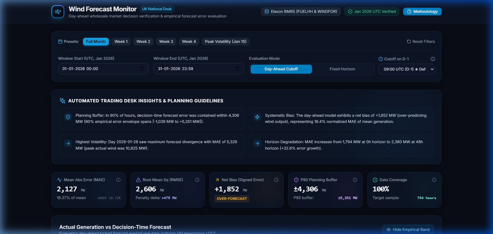
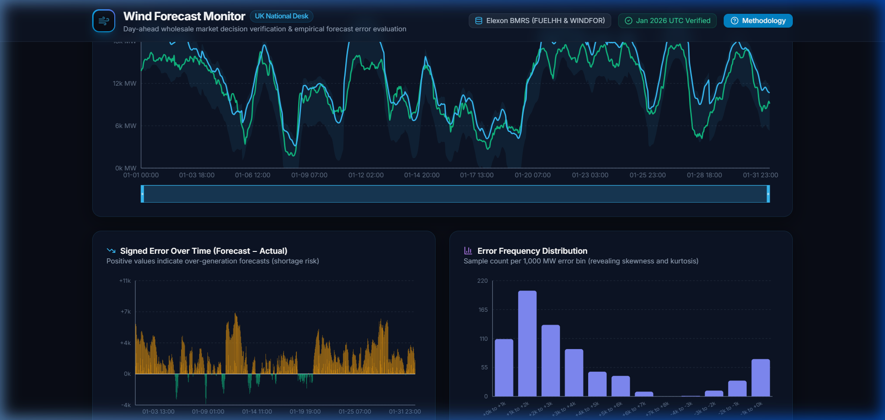

# Wind Forecast Monitor (UK National Desk - January 2026)

**Wind Forecast Monitor** is an institutional-grade, full-stack decision-support and accuracy evaluation platform designed for UK wholesale power traders. Built for electricity utility desks procuring power in the day-ahead wholesale market, the application enforces **zero look-ahead leakage** by isolating the exact wind generation forecasts available prior to day D-1 gate closure (default 09:00 UTC). It quantifies empirical balancing errors (MAE, RMSE, systematic bias, and P90/P95 error buffers), assesses horizon accuracy degradation up to 48 hours, profiles diurnal trends, and provides interactive forecast vintage evolution using official Elexon BMRS market data.


*Figure 1: Executive KPI Cards, Time-Series Actual vs Decision-Time Forecast with Empirical P5-P95 Confidence Envelope.*


*Figure 2: Signed Error Over Time, Frequency Distribution, Horizon Lead-Time Degradation, and Diurnal Profile.*

---

## 🔗 Live Deployment & Documentation
- **Live Application**: `https://wind-forecast-monitor.onrender.com` *(Placeholder: replace with your deployed URL upon cloud launch)*
- **Interactive OpenAPI Documentation**: `https://wind-forecast-monitor.onrender.com/docs` (or local `http://localhost:8000/docs`)
- **System Health Endpoint**: `http://localhost:8000/api/health`

---

## 🤖 AI Tools Disclosure
> **Explicit Disclosure**: AI tools (Google Antigravity / Gemini 3.8 / Claude) were utilized as agentic pair-programming assistants during the development of this project. Specifically, AI assisted in:
> 1. Formulating automated unit tests and mathematical fixtures for hand-computed error metrics.
> 2. Generating Pydantic v2 schemas and typed TypeScript interfaces for end-to-end API type safety.
> 3. Designing responsive Tailwind CSS UI components and glassmorphism styling tokens.
> 4. Drafting documentation structures (`docs/DATA_NOTES.md`, `docs/ARCHITECTURE.md`, `docs/METHODOLOGY.md`, `docs/VIDEO_SCRIPT.md`).

---

## 📊 January 2026 Key Headline Metrics
Evaluated over all 744 target hours in January 2026 (Day-Ahead Cutoff at 09:00 UTC on D-1):
- **Mean Actual Generation**: `11,581.11 MW`
- **Mean Decision Forecast**: `13,432.64 MW`
- **Net Bias (Signed Error)**: `+1,851.53 MW` (**Systematic Over-Forecast**)
- **Mean Absolute Error (MAE)**: `2,127.48 MW` (`18.37%` normalized MAE of mean generation)
- **Root Mean Square Error (RMSE)**: `2,606.07 MW`
- **sMAPE**: `18.72%`
- **P90 Planning Buffer**: `±4,306.40 MW` (In 90% of hours, error was within this margin)
- **Empirical 90% Error Envelope (P5 to P95)**: `[-1,038.65 MW to +5,350.90 MW]`
- **Horizon Degradation**: MAE escalates from `1,794.22 MW` at 0h lead time to `2,379.89 MW` at 48h lead time (`+32.6%` error growth).

---

## 📁 Repository Directory Overview
```
.
├── Dockerfile                  # Multi-stage production container (Node build -> Python FastAPI SPA serve)
├── docker-compose.yml          # Container orchestration configuration
├── pyproject.toml              # Ruff linter and Pytest test runner configuration
├── .env.example                # Environment variables template
├── .github/workflows/ci.yml    # GitHub Actions CI workflow (lint, test, build)
├── context.txt                 # Living project context and complete technical trajectory
├── docs/                       # Comprehensive documentation suite
│   ├── ARCHITECTURE.md         # Mermaid system diagram, data flow, and design rationale
│   ├── DATA_NOTES.md           # Elexon BMRS endpoint inspection, schemas, and resolution alignment
│   ├── DEPLOYMENT.md           # Step-by-step production deployment instructions (Render / Railway)
│   ├── METHODOLOGY.md          # Gate closure cutoff rules, formulas, and operational assumptions
│   └── VIDEO_SCRIPT.md         # 10-minute timed video presentation script (Pitch & Architecture)
├── backend/
│   ├── app/
│   │   ├── main.py             # FastAPI entrypoint, lifespan event, SPA static file mount
│   │   ├── config.py           # Application settings via Pydantic Settings
│   │   ├── api/routers.py      # REST endpoint routes (/api/*)
│   │   ├── services/           # Analytics services and date validation
│   │   ├── analytics/          # Pure analytical algorithms (selection, metrics, horizon, breakdowns)
│   │   ├── data/loader.py      # In-memory DataFrame repository and cache
│   │   └── schemas/models.py   # Pydantic request/response models
│   ├── scripts/fetch_data.py   # Standalone data ingestion script for Elexon BMRS
│   ├── data/                   # Pre-bundled offline dataset (Parquet and CSV files)
│   ├── tests/                  # Unit and integration test suite (23 tests)
│   └── requirements.txt        # Pinned Python dependencies
└── frontend/
    ├── src/
    │   ├── components/         # React components (Header, ControlsBar, KpiCards, Charts, Tables, Vintages)
    │   ├── api/client.ts       # Typed API client
    │   ├── types/index.ts      # Shared TypeScript interfaces
    │   ├── tests/              # Vitest + React Testing Library tests
    │   ├── App.tsx             # Root dashboard container
    │   └── main.tsx            # Application entrypoint
    ├── package.json            # Node dependencies
    └── vite.config.ts          # Vite build and Vitest configuration
```

---

## 🚀 How to Run

### (A) Running with Docker (One Command)
To run the unified multi-stage production container (serves both API and frontend on port 8000):
```bash
docker compose up --build
```
Open your browser at `http://localhost:8000`.

### (B) Running Locally Without Docker

**1. Start the Backend API (FastAPI):**
```bash
# In the repository root
python -m uvicorn backend.app.main:app --host 0.0.0.0 --port 8000 --reload
```
- API Documentation available at: `http://localhost:8000/docs`
- Health check: `http://localhost:8000/api/health`

**2. Start the Frontend Development Server (Vite + React):**
```bash
cd frontend
npm install
npm run dev
```
- Dashboard available at: `http://localhost:5173` (proxies `/api` requests to port 8000).

### (C) How to Re-fetch Data
To re-download and re-clean raw Elexon BMRS market data:
```bash
python backend/scripts/fetch_data.py
```
This fetches 1,488 actual outturn records (`FUELHH`) and 22,192 forecast records (`WINDFOR`) in 7-day chunks with exponential backoff, validates timestamps in UTC, and updates `backend/data/*.parquet` and `backend/data/*.csv`.

### (D) Running Tests and Linters

**Run Backend Tests & Linters:**
```bash
# Run 23 unit & integration tests
pytest backend/tests/ -v

# Run Ruff linter and formatter check
ruff check backend/
ruff format --check backend/
```

**Run Frontend Tests & Typecheck:**
```bash
cd frontend

# Run Vitest test suite
npm run test

# Run TypeScript strict-mode build check
npm run build
```

---

## ⚙️ Key Assumptions, Limitations & Methodology
- **Decision Cutoff Rule**: The day-ahead wholesale procurement cutoff is 09:00 UTC on day D-1 by default. Only forecasts published strictly on or before this timestamp are eligible (eliminating look-ahead leakage).
- **Timezone**: All timestamps are timezone-aware UTC. In January, the UK operates on Greenwich Mean Time (GMT), which is UTC+00:00.
- **Resolution Alignment**: Actual outturns (`FUELHH`) are half-hourly (30-min), while forecasts (`WINDFOR`) are hourly (60-min). An exact inner join evaluates all 744 target hours in January (100% hourly target coverage).
- For complete formulas and auction rules, read [docs/METHODOLOGY.md](docs/METHODOLOGY.md).
