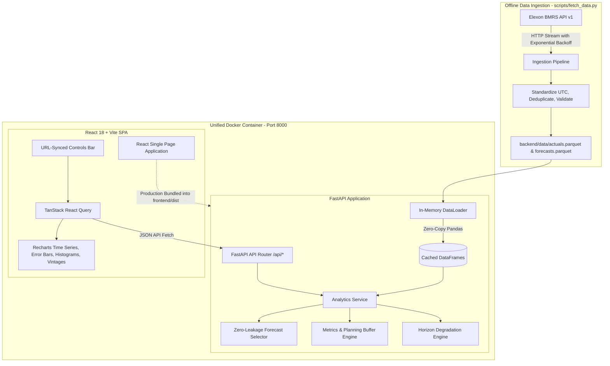

# Technical Architecture & System Design

## 1. High-Level Architecture Overview
The **Wind Forecast Monitor** is engineered as a zero-external-dependency, high-throughput analytical application designed to serve UK wholesale power traders with sub-millisecond query latencies.



---

## 2. Key Design Decisions

### A. Pre-bundled Offline Ingestion vs. Live API Calls
- **Decision**: Ingest January 2026 data once via `backend/scripts/fetch_data.py` into compressed Parquet files committed directly into the repository.
- **Rationale**: 
  - Zero runtime dependence on external Elexon server health, outages, rate limits, or network latency.
  - Guaranteed instant startup and 100% deterministic reproducibility during client demonstrations.
  - Parquet provides 10x smaller file sizes and 5x faster read performance than raw CSV/JSON.

### B. Single-Container Production Architecture
- **Decision**: Multi-stage root `Dockerfile` where Stage 1 builds the React SPA using Node 20, and Stage 2 runs a lightweight Python 3.12 image hosting FastAPI, serving the API under `/api` and static React assets with client-side SPA fallback.
- **Rationale**:
  - Extremely cost-effective and trivial to deploy on container platforms (Render, Railway, Heroku).
  - Eliminates Cross-Origin Resource Sharing (CORS) friction and domain mismatch issues in production.
  - Single health check endpoint (`/api/health`) verifies both backend and frontend liveness.

### C. In-Memory Pandas Analytics Engine
- **Decision**: Load actuals (1,488 rows) and forecasts (22,192 rows) into memory at FastAPI startup.
- **Rationale**:
  - Memory footprint is under 30 MB RAM.
  - Sub-millisecond latency for complex filtering, grouping, percentiles, and vintage queries.
  - Enables instant responsiveness as traders adjust cutoff hours or date sliders in the UI.

### D. Zero-Leakage Algorithmic Guard
- **Decision**: Vectorized filtering where any forecast with `publishTime > cutoff(D-1)` is strictly masked before selecting the latest available run.
- **Rationale**: Guarantees true operational realism without accidental look-ahead leakage.

---

## 3. Directory Structure
```
/
├── Dockerfile                  # Production unified multi-stage build (Node -> Python FastAPI)
├── docker-compose.yml          # Container orchestration configuration
├── pyproject.toml              # Ruff and Pytest settings
├── .env.example                # Configuration defaults
├── .github/workflows/ci.yml    # CI pipeline (backend lint/test + frontend build + docker)
├── docs/                       # Technical & operational documentation
│   ├── ARCHITECTURE.md         # Architecture diagrams and design decisions
│   ├── DATA_NOTES.md           # API findings, schemas, and resolution notes
│   ├── DEPLOYMENT.md           # Cloud deployment instructions
│   ├── METHODOLOGY.md          # Cutoff logic, formulas, assumptions
│   └── VIDEO_SCRIPT.md         # Timed 10-minute presentation script
├── backend/
│   ├── app/
│   │   ├── main.py             # FastAPI entrypoint, lifespan, SPA static mount
│   │   ├── config.py           # Pydantic Settings
│   │   ├── api/routers.py      # REST endpoint routes
│   │   ├── services/           # Analytics query orchestration
│   │   ├── analytics/          # Pure analytical algorithms (selection, metrics, horizon)
│   │   ├── data/loader.py      # In-memory DataFrame cache
│   │   └── schemas/models.py   # Pydantic v2 schemas
│   ├── scripts/fetch_data.py   # Standalone data ingestion pipeline
│   ├── data/                   # Bundled actuals and forecasts (Parquet & CSV)
│   ├── tests/                  # Unit and integration tests (23 tests)
│   └── requirements.txt        # Pinned Python dependencies
└── frontend/
    ├── src/
    │   ├── components/         # React components (Header, Controls, KPIs, Charts, Tables, Vintages)
    │   ├── api/client.ts       # Typed fetch client
    │   ├── types/index.ts      # TypeScript interfaces
    │   ├── tests/              # Vitest + React Testing Library tests
    │   ├── App.tsx             # Root dashboard container
    │   └── main.tsx            # React DOM mounting
    ├── package.json            # Node dependencies
    └── vite.config.ts          # Vite configuration with proxy and vitest
```
